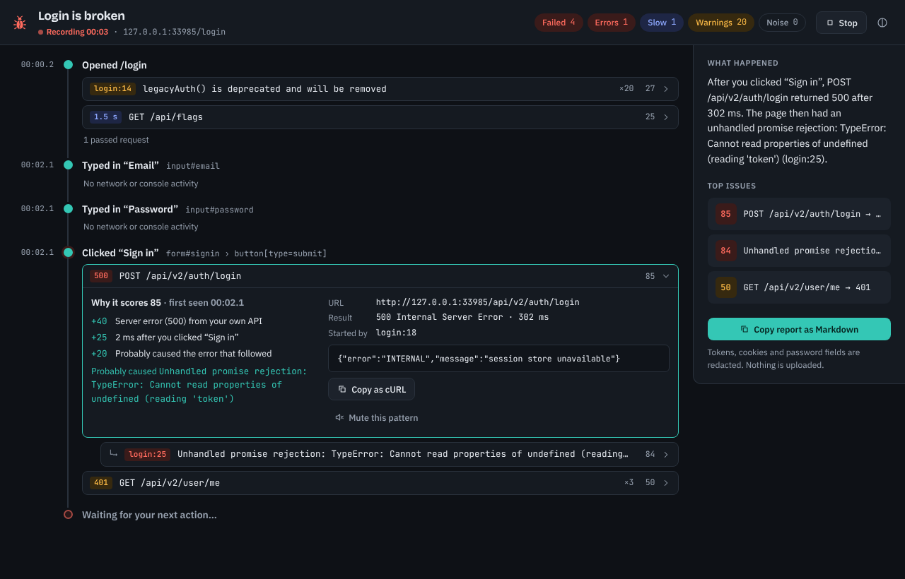
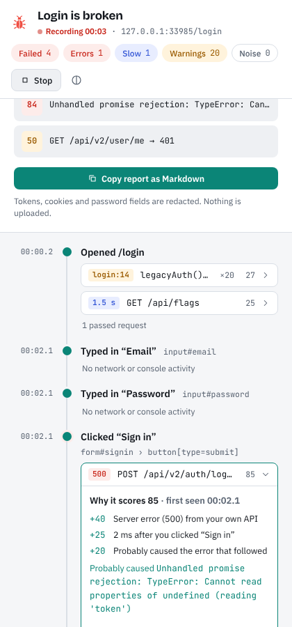
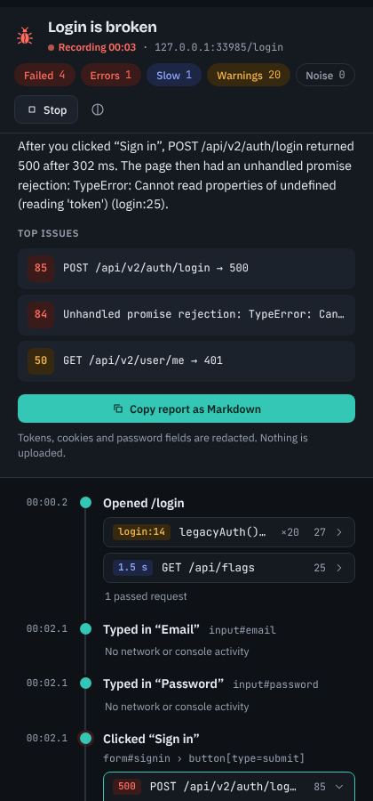

<p align="center">
  
</p>

<h1 align="center">BugTrail</h1>

<p align="center"><b>Debug by workflow, not by browser tab.</b><br>
A Chrome extension that ties every failed request and error to the action that caused it, ranks them by impact, and writes the bug report for you.</p>

<p align="center">
  
</p>

---

## Why

DevTools shows _everything_: 128 requests, 54 console messages, five panels. When “login is broken”, the hard part isn't seeing data, it's finding the one request that failed, the error it caused, and the click that started it, then explaining all that to someone else.

BugTrail is built around three ideas:

1. **Debug by workflow.** Name what you're testing, reproduce it, and BugTrail groups what happened by _your actions_: “Clicked Sign in → `POST /api/login` 500 → TypeError in `auth.ts:42`”.
2. **Signal over noise.** Problems are ranked by impact, and every score explains itself (“+40 server error on your own API, +25 1 ms after you clicked Sign in…”). Repeated messages collapse into one row; known noise (favicon 404s, ad-blocked trackers, dev-only warnings) is hidden.
3. **Debugging produces an artifact.** One click copies a report (summary, steps to reproduce, ranked issues and request details) with tokens, cookies and passwords redacted.

## What's in v0.1

|                         |                                                                                                      |
| ----------------------- | ---------------------------------------------------------------------------------------------------- |
| **Story view**          | One chapter per user action (page loads, clicks, typing, submits) with the problems it caused        |
| **Causal links**        | Errors are linked to the failed request that most likely caused them and drawn underneath it         |
| **Explainable ranking** | Impact score with reasons; causes always rank above their effects                                    |
| **Filters**             | Failed · Errors · Slow (relative to the session's median) · Warnings · Noise                         |
| **Grouping & muting**   | Near-identical messages and requests are grouped; mute any pattern for the rest of the investigation |
| **Report**              | Copy as Markdown; copy any request as cURL; everything redacted                                      |
| **Three surfaces**      | Side panel (for testers), a DevTools tab (for developers) and a toolbar popup                        |
| **Themes**              | Light and dark, following the system or set by hand                                                  |

<p>
  
  
</p>

## Install (from source)

Requires Node.js 22.12+ and Chrome/Chromium 116+.

```sh
git clone https://github.com/buvana-seshathri/BugTrail.git
cd BugTrail
npm ci
npm run build
```

Then open `chrome://extensions`, turn on **Developer mode**, click **Load unpacked** and choose the `dist/` folder.

## Use it

1. Open the page you're testing and click the BugTrail icon → **Start investigation** (or open the **BugTrail** tab in DevTools).
2. Reproduce the problem. Chrome shows a “BugTrail started debugging this browser” bar while recording. That's how BugTrail sees network and console activity.
3. Read the story, open any row to see why it ranks where it does, then **Copy report as Markdown** and paste it into your tracker.

## Privacy

- **Local only.** Nothing is uploaded. Recordings live in memory and session storage and disappear when the browser closes.
- **Minimal permissions:** `debugger` (to read network and console activity of the tab you're investigating, only while recording), `sidePanel`, and `storage`. No host permissions and no content scripts on every site.
- **Typed values are never recorded.** The page probe records _which_ field you typed in, never _what_ you typed.
- **Exports are redacted:** `Authorization`, cookies, API keys, and password- or token-like fields in URLs, headers and bodies.

## Roadmap

Ideas we'd love help with (see [issues](https://github.com/buvana-seshathri/BugTrail/issues)):

- **Shareable HTML report**: a self-contained page with the selected element and a timeline
- **Reproduce mode**: replay a report's failed responses as mock rules (status, body, delay)
- **Workbench layout**: the three-pane DevTools layout with a timeline strip ([design](docs/DESIGN.md))
- **Element picker** to attach the broken element to a report
- **Firefox** support (page-probe capture, without `chrome.debugger`)
- Better first-party detection with the Public Suffix List
- More noise rules for popular frameworks

## Contributing

Contributions are very welcome. Start with [CONTRIBUTING.md](CONTRIBUTING.md) and [docs/ARCHITECTURE.md](docs/ARCHITECTURE.md). The analysis engine is plain TypeScript with no browser APIs, so most improvements can be made and tested without touching Chrome at all.

## License

[MIT](LICENSE)
